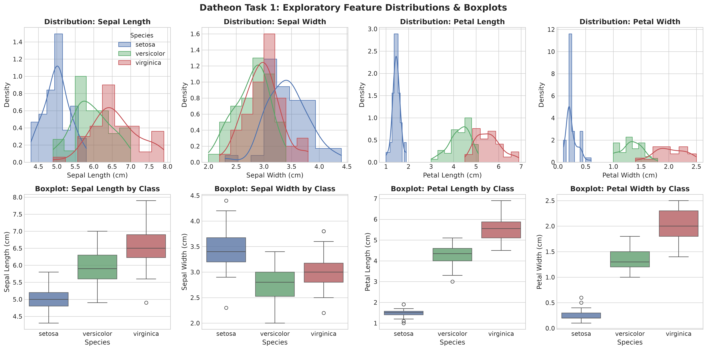
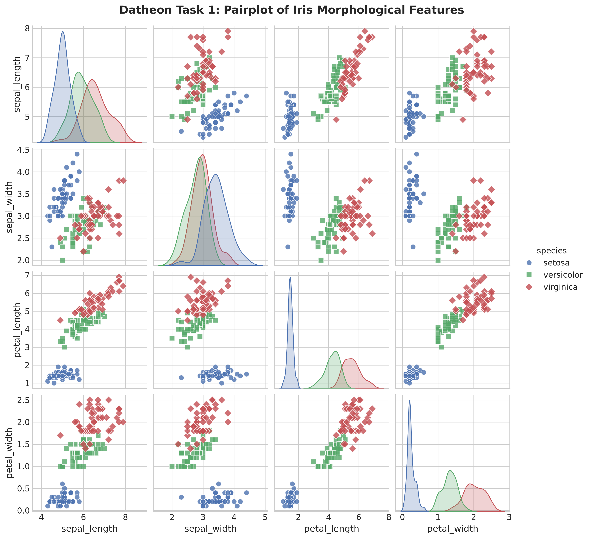
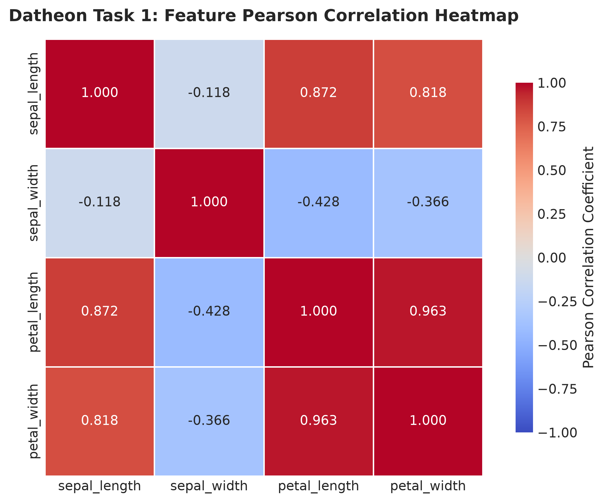
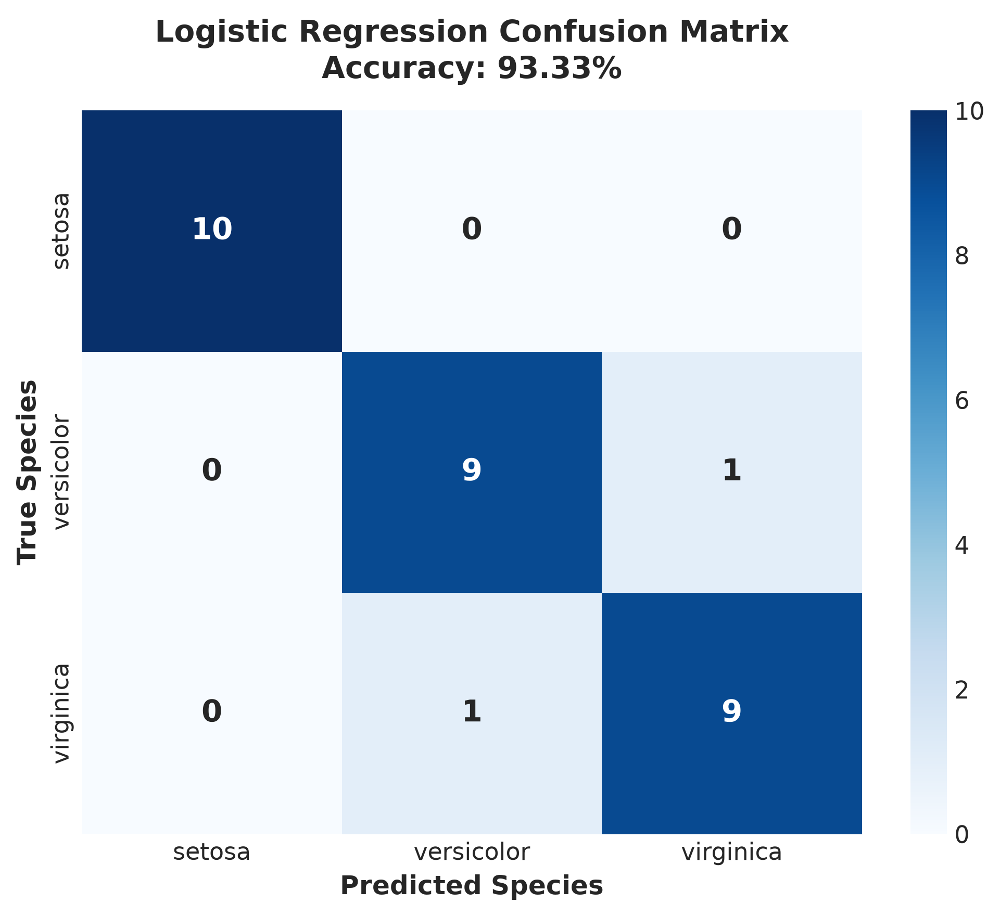
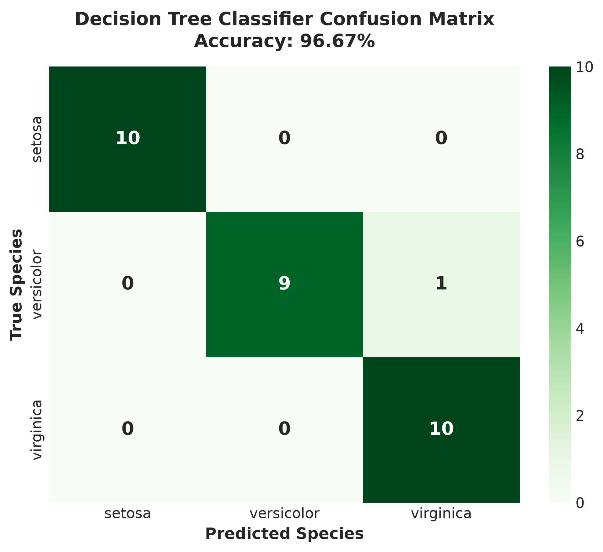
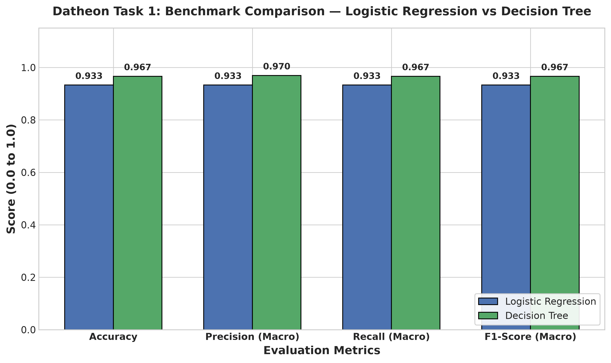
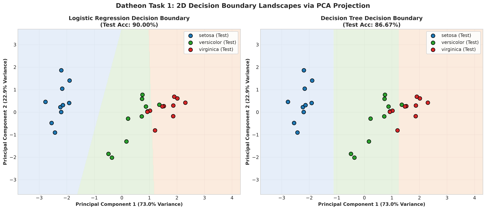

# Task 1: Multi-Class Benchmark Classification Pipeline (Iris Dataset)

[](https://www.python.org/)
[](https://scikit-learn.org/)
[]()
[](https://www.datheon.in/)

---

## 📌 Internship Information

- **Organization:** [Datheon — AI Systems & Automation Studio](https://www.datheon.in/)
- **Program:** Machine Learning & Data Science Internship (4-Week Intensive Track)
- **Intern Name:** G. Chakravarthi Shiva Sai
- **Internship ID:** DT-2026-UKTYN
- **Task Identifier:** Task 1 — Multi-Class Benchmark Classification Pipeline

---

## 📖 Executive Summary & Problem Statement

Supervised classification is a core branch of predictive modeling where algorithm pipelines learn decision boundaries from feature representations to categorize observations into discrete classes.

The objective of **Task 1** is to build an end-to-end, leak-free classification pipeline using Scikit-Learn on the official Datheon benchmark dataset (`iris.csv`). The pipeline benchmarks two contrasting learning paradigms:
1. **Parametric / Linear Model:** Multinomial Logistic Regression with $L_2$ regularization.
2. **Non-Parametric / Tree-Based Model:** Decision Tree Classifier with Gini impurity splitting.

The study includes rigorous Exploratory Data Analysis (EDA), stratified train-test splitting (80/20), zero-data-leakage feature standardization (`StandardScaler`), metric benchmarking (Accuracy, Precision, Recall, F1-Score under both Macro and Weighted averaging), confusion matrix analysis, and two-dimensional decision boundary projections via Principal Component Analysis (PCA).

---

## 📊 Dataset Description

The dataset provided directly by Datheon is the canonical **Fisher's Iris Dataset**:

- **Total Samples:** 150 records
- **Class Distribution:** Perfectly balanced across 3 botanical species (50 samples per class):
  - `setosa` (Iris Setosa)
  - `versicolor` (Iris Versicolor)
  - `virginica` (Iris Virginica)
- **Feature Set:** 4 continuous morphological features (measured in centimeters):
  - `sepal_length`: Sepal length in cm
  - `sepal_width`: Sepal width in cm
  - `petal_length`: Petal length in cm
  - `petal_width`: Petal width in cm
- **Missing Values:** 0 null values across all columns
- **Duplicate Rows:** 1 row (row 142 is identical to row 101, retained as valid natural sample measurement)

---

## 🛠️ Technologies & Libraries

- **Language:** Python 3.10+ (tested on Python 3.14.5)
- **Data Manipulation:** `pandas>=2.0.0`, `numpy>=1.24.0`
- **Machine Learning & Preprocessing:** `scikit-learn>=1.3.0`
- **Visualization:** `matplotlib>=3.7.0`, `seaborn>=0.12.0`
- **Interactive Development:** `jupyter`, `notebook`, `ipykernel`

---

## 🔬 Methodology & Pipeline Architecture

```
[Raw iris.csv Dataset]
          │
          ▼
[Exploratory Data Analysis] (Distributions, Boxplots, Pairplot, Correlation Matrix)
          │
          ▼
[Stratified 80/20 Split] (Train: 120 samples, Test: 30 samples; random_state=42)
          │
          ▼
[Atomic Scikit-Learn Pipelines] ───► Prevents Data Leakage!
   ├── StandardScaler() (fitted strictly on training fold)
   └── Classifier:
         ├── Model 1: LogisticRegression(max_iter=1000, random_state=42)
         └── Model 2: DecisionTreeClassifier(max_depth=3, random_state=42)
          │
          ▼
[Model Evaluation & Benchmarking] (Accuracy, Precision, Recall, F1-Score, Confusion Matrices)
          │
          ▼
[Dimensionality Reduction & Decision Boundaries] (PCA 2D Projection: 95.81% Variance)
```

### Prevention of Data Leakage
Feature normalization via `StandardScaler` standardizes variables to zero mean and unit variance. If computed across the entire dataset before splitting, properties of the test set leak into training. To eliminate leakage:
- All transformations are isolated inside Scikit-Learn `Pipeline` constructs.
- Transformers fit parameters exclusively on `X_train` and apply those static parameters to `X_test`.

---

## 📈 Exploratory Data Analysis & Visualizations

### 1. Feature Distributions & Boxplots
Visualizing univariate histograms with Kernel Density Estimation (KDE) alongside quartile boxplots reveals clear morphological divergence across classes.



### 2. Pairwise Feature Interactions
Seaborn pairplots show that `setosa` is linearly separable from the other two species across petal dimensions. `versicolor` and `virginica` exhibit slight continuous overlap.



### 3. Pearson Correlation Matrix
High positive correlation ($r = 0.963$) is observed between `petal_length` and `petal_width`.



---

## 🏆 Actual Benchmark Evaluation Results

Both models were evaluated on the held-out 20% test fold (30 samples: 10 setosa, 10 versicolor, 10 virginica).

### Comprehensive Benchmark Table

| Model | Test Accuracy | Precision (Macro) | Recall (Macro) | F1-Score (Macro) | Precision (Weighted) | Recall (Weighted) | F1-Score (Weighted) |
| :--- | :---: | :---: | :---: | :---: | :---: | :---: | :---: |
| **Logistic Regression** | **93.33%** (0.9333) | 0.9333 | 0.9333 | 0.9333 | 0.9333 | 0.9333 | 0.9333 |
| **Decision Tree Classifier** | **96.67%** (0.9667) | **0.9697** | **0.9667** | **0.9666** | **0.9697** | **0.9667** | **0.9666** |

### Multi-Class Averaging Rationale
- **Macro Average:** Computes the arithmetic mean of per-class metrics without weighting by class support. Since our stratified test set is balanced (10 samples per class), Macro averaging provides an unbiased evaluation treating all species with equal weight.
- **Weighted Average:** Weights per-class metrics by true instance frequencies. On balanced test sets, Macro and Weighted scores converge.

### Classification Reports

#### Logistic Regression
```
              precision    recall  f1-score   support

      setosa       1.00      1.00      1.00        10
  versicolor       0.90      0.90      0.90        10
   virginica       0.90      0.90      0.90        10

    accuracy                           0.93        30
   macro avg       0.93      0.93      0.93        30
weighted avg       0.93      0.93      0.93        30
```

#### Decision Tree Classifier
```
              precision    recall  f1-score   support

      setosa       1.00      1.00      1.00        10
  versicolor       1.00      0.90      0.95        10
   virginica       0.91      1.00      0.95        10

    accuracy                           0.97        30
   macro avg       0.97      0.97      0.97        30
weighted avg       0.97      0.97      0.97        30
```

---

## 🔍 Confusion Matrices

Confusion matrices illuminate specific classification errors on the 30-sample test set:
- **Logistic Regression:** 2 misclassifications (1 `versicolor` predicted as `virginica`; 1 `virginica` predicted as `versicolor`).
- **Decision Tree Classifier:** Only 1 misclassification (1 `versicolor` predicted as `virginica`).

| Logistic Regression Confusion Matrix | Decision Tree Confusion Matrix |
| :---: | :---: |
|  |  |

---

## 📊 Benchmark Metric Comparison

Comparison across Accuracy, Macro Precision, Macro Recall, and Macro F1-Score:



---

## 🗺️ Decision Boundary Visualization via PCA

### Why PCA is Used
Visualizing 4-dimensional hyperplanes directly in 2D is geometrically impossible. **Principal Component Analysis (PCA)** is utilized to project the standardized 4D feature space onto two principal components:
- **PC1 (72.96% variance):** Dominantly reflects petal length and width (overall floral size).
- **PC2 (22.85% variance):** Reflects sepal width contrast.
- **Total Variance Retained:** **95.81%**, guaranteeing that the 2D decision landscape faithfully preserves true geometric relationships.



- **Logistic Regression:** Produces smooth linear hyperplanes dividing classes.
- **Decision Tree:** Forms orthogonal, axis-aligned step partitions.

---

## 🚀 Installation & Execution Instructions

### 1. Clone the Repository
```bash
git clone https://github.com/futuristicchakri3/Datheon_Machine_Learning_and_Data_Science_Internship.git
cd Datheon_Machine_Learning_and_Data_Science_Internship
```

### 2. Set Up Virtual Environment
```bash
# Windows
python -m venv .venv
.\.venv\Scripts\activate

# Linux / macOS
python3 -m venv .venv
source .venv/bin/activate
```

### 3. Install Required Dependencies
```bash
pip install -r requirements.txt
```

### 4. Run the Pipeline Script
To re-run the pipeline and regenerate all figures:
```bash
python Task_1_Classification/generate_pipeline.py
```

### 5. Launch the Interactive Jupyter Notebook
```bash
jupyter notebook Task_1_Classification/notebooks/classification.ipynb
```

---

## 🎯 Conclusion

1. **Top Performer:** The **Decision Tree Classifier** emerged as the champion model on this dataset, achieving **96.67% accuracy** and an **F1-score of 0.9666**, outperforming Logistic Regression (**93.33% accuracy**, **0.9333 F1-score**).
2. **Feature Impact:** Petal dimensions (`petal_length` and `petal_width`) provide the strongest discriminative power for flower speciation.
3. **Pipeline Reusability:** The Scikit-Learn `Pipeline` architecture ensures robust generalization, complete reproducibility, and zero data leakage.
