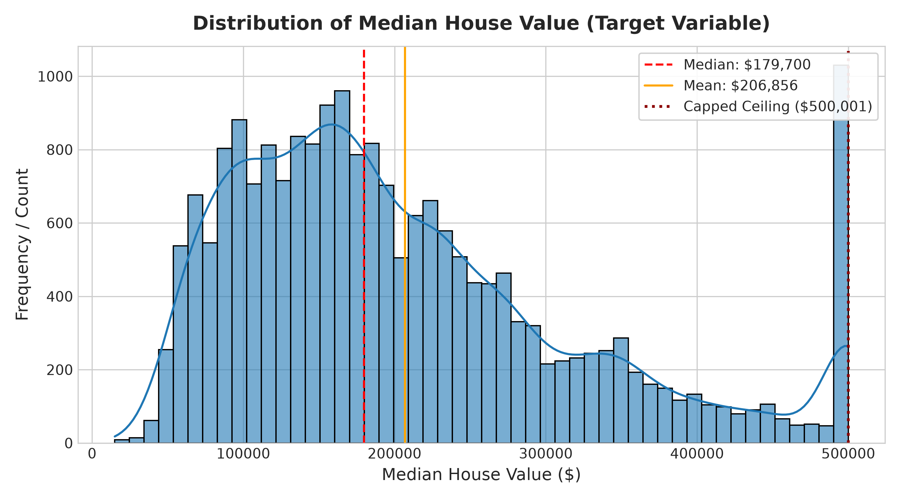
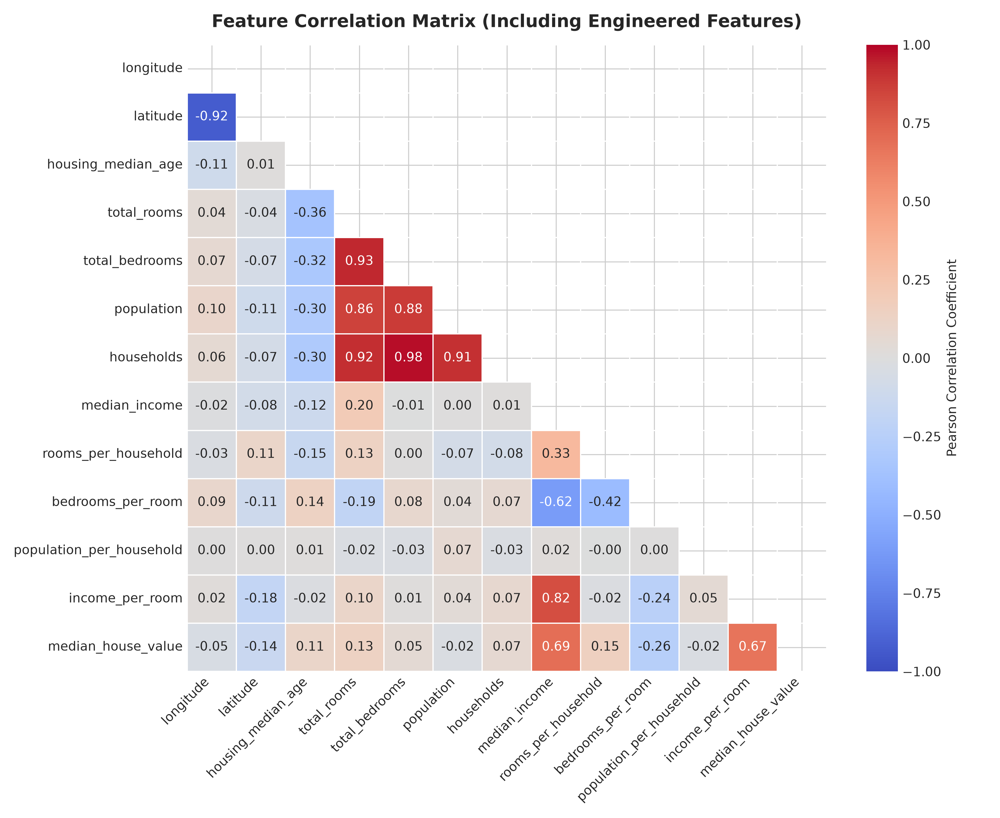
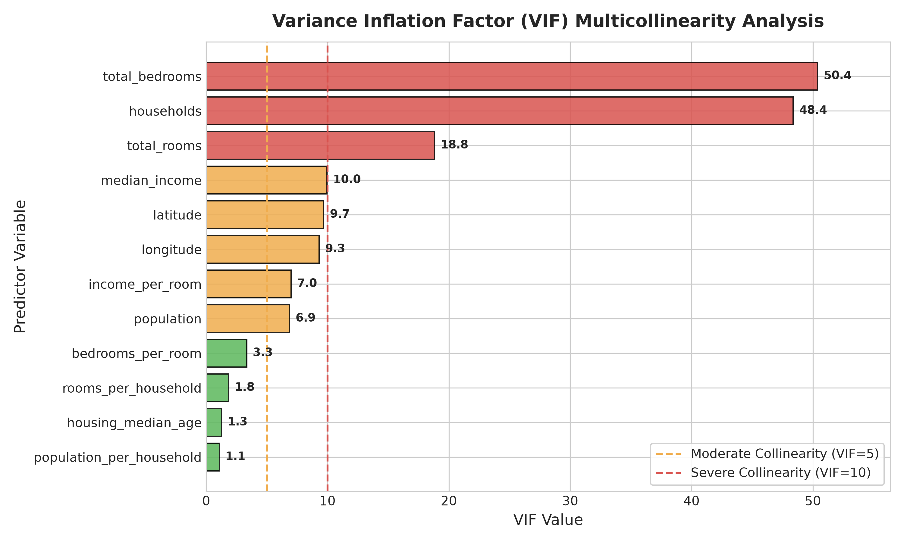
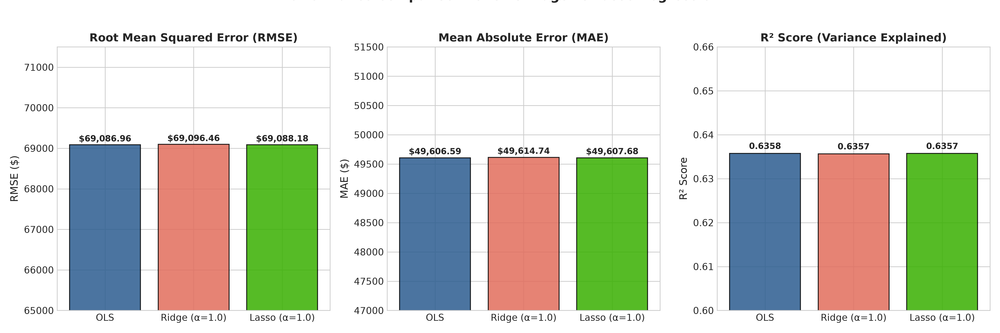
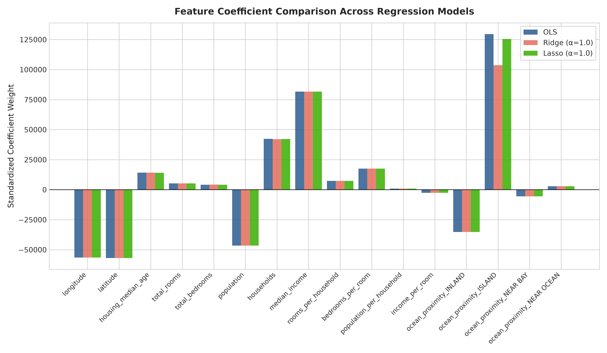
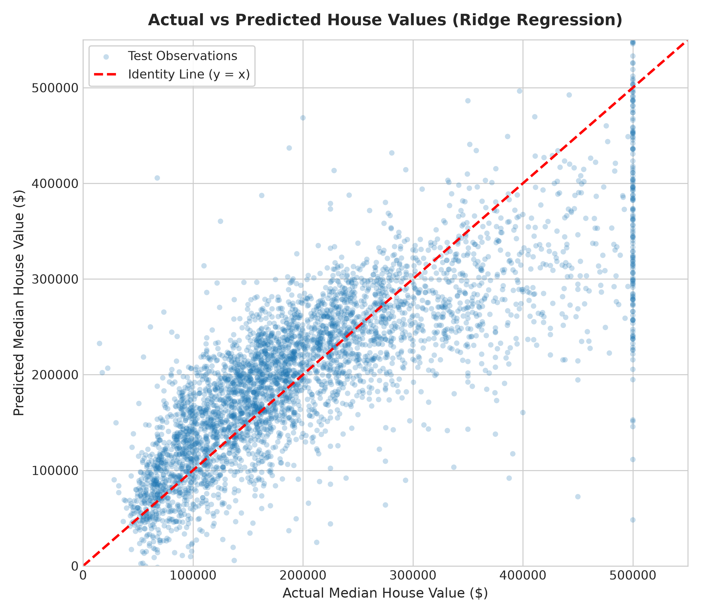
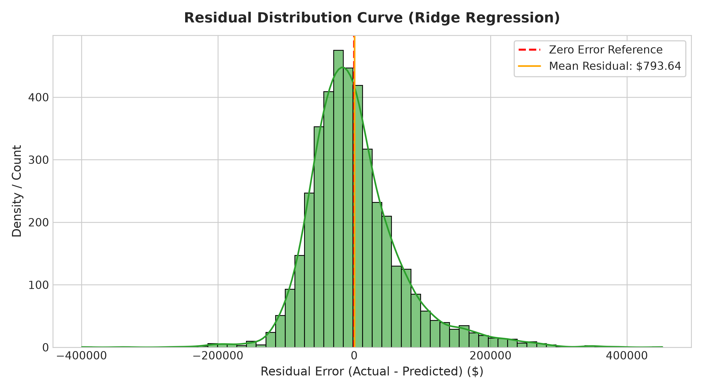
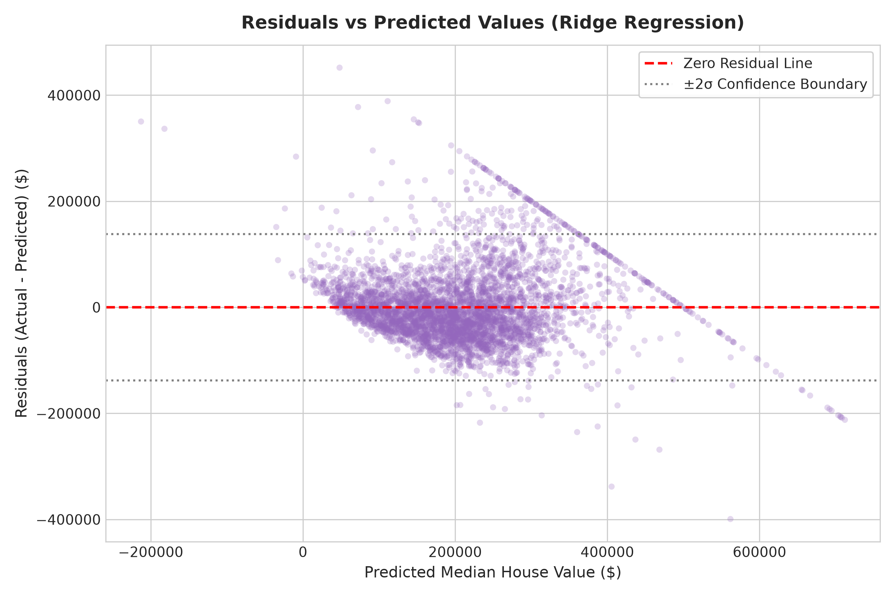

# Task 2: Real Estate Housing Price Prediction (Ridge & Lasso Regression)


---

## 👨‍💻 Intern Profile
- **Name:** G. Chakravarthi Shiva Sai
- **Internship ID:** DT-2026-UKTYN
- **Domain:** Machine Learning & Data Science
- **Organization:** [Datheon — AI Systems & Automation Studio](https://www.datheon.in/)

---

## 📌 Executive Summary
**Task 2** establishes an enterprise-grade continuous regression benchmarking framework predicting median real estate housing values across California census districts using the authentic **California Housing** dataset.

The investigation rigorously compares three fundamental regression paradigms:
1. **Ordinary Least Squares (OLS):** Unregularized maximum likelihood parameter estimation.
2. **Ridge Regression ($L_2$ Regularization):** Quadratic weight penalization resolving ill-conditioned covariance matrices and stabilizing variance on correlated and sparse attributes.
3. **Lasso Regression ($L_1$ Regularization):** Absolute weight shrinkage inducing parameter sparsity and automated feature selection.

All preprocessing transformations, median/mode imputations, standard scaling, and one-hot encodings are encapsulated inside leak-free Scikit-Learn pipelines fitted strictly on the 80% training partition, preventing data leakage across all 5-fold cross-validation iterations.

---

## 🎯 Detailed Problem Statement & Requirements
Predict continuous district `median_house_value` using demographic, structural, and geographic predictors from the 1990 U.S. Census in California. 

Key assignment deliverables:
1. Load and validate the official 20,640-record dataset.
2. Formulate domain-specific structural ratio and interaction features using numerically safe division.
3. Diagnose and explain multicollinearity using Pearson correlation matrices and Variance Inflation Factor (VIF).
4. Construct an atomic Scikit-Learn `ColumnTransformer` preventing data leakage.
5. Benchmark **OLS**, **Ridge**, and **Lasso** with 5-fold cross-validated hyperparameter tuning via `GridSearchCV`.
6. Evaluate test generalization on **RMSE**, **MAE**, and **$R^2$ Score**.
7. Execute in-depth residual diagnostics analyzing mean bias, normality, homoscedasticity, and boundary constraints.

---

## 📊 Dataset Overview & Validation

The dataset is programmatically downloaded from the authentic repository source:
`https://raw.githubusercontent.com/ageron/handson-ml2/master/datasets/housing/housing.csv`

```
Total Observations: 20,640 census block groups
Total Attributes:   10 original features (9 continuous, 1 categorical)
Target Variable:    median_house_value (Continuous USD, capped at $500,001)
Missing Entries:    total_bedrooms has 207 missing values (1.003%); imputed via median
Duplicate Records:  0 duplicate rows detected
```

### Feature Taxonomy:
| Feature | Type | Unit / Description | Role |
| :--- | :---: | :--- | :--- |
| `longitude` | Continuous | Geographic coordinate West (degrees) | Predictor |
| `latitude` | Continuous | Geographic coordinate North (degrees) | Predictor |
| `housing_median_age` | Continuous | Median age of housing structures in the block (years) | Predictor |
| `total_rooms` | Continuous | Cumulative count of rooms in the block | Predictor |
| `total_bedrooms` | Continuous | Cumulative count of bedrooms in the block (contains missing values) | Predictor |
| `population` | Continuous | Total block residents count | Predictor |
| `households` | Continuous | Total occupied residential housing units count | Predictor |
| `median_income` | Continuous | Median household income (tens of thousands of USD) | Predictor |
| `ocean_proximity` | Categorical | 5 categories: `<1H OCEAN`, `INLAND`, `NEAR OCEAN`, `NEAR BAY`, `ISLAND` | Predictor |
| **`median_house_value`** | **Continuous** | **Median block housing valuation (USD)** | **Target** |

<p align="center">
  
</p>

*Key observation:* The target distribution exhibits moderate positive skewness, with a prominent ceiling spike at \$500,001 representing artificially capped records from the 1990 census.

---

## 🛠️ Data Preprocessing & Leakage Prevention

To ensure strict academic and production validity, **zero data leakage** is enforced:
1. **Train-Test Partition:** The dataset is split into **80% training** (16,512 samples) and **20% testing** (4,128 samples) with `random_state=42`.
2. **Numerical Pipeline:**
   - Missing values are imputed using **Median Imputation** (`SimpleImputer(strategy='median')`), calculated strictly on `X_train`.
   - Continuous features are normalized to zero mean and unit variance using `StandardScaler()`.
3. **Categorical Pipeline:**
   - Categorical missing values are filled with **Most Frequent** imputation.
   - `ocean_proximity` is encoded using `OneHotEncoder(drop='first', sparse_output=False)` to prevent the dummy variable trap in OLS regression.
4. **ColumnTransformer:** Encapsulates the numerical and categorical transformers, ensuring that scaling parameters ($\mu, \sigma$) and imputation statistics are learned solely during `fit()` calls on training data.

---

## 🔬 Feature Engineering & Interaction Analysis

Aggregate census block counts (`total_rooms`, `total_bedrooms`, `population`, `households`) do not reflect property-level characteristics. We engineer three structural ratios and one economic interaction term using numerically stabilized division ($\epsilon = 10^{-6}$):

1. **`rooms_per_household`:** $\frac{\text{total\_rooms}}{\text{households} + \epsilon}$ — Proxy for residential dwelling capacity.
2. **`bedrooms_per_room`:** $\frac{\text{total\_bedrooms}}{\text{total\_rooms} + \epsilon}$ — Ratio of bedrooms to total rooms (inversely correlated with price: $-0.2559$).
3. **`population_per_household`:** $\frac{\text{population}}{\text{households} + \epsilon}$ — Density per residence.
4. **`income_per_room` (Interaction):** $\frac{\text{median\_income}}{\text{rooms\_per\_household} + \epsilon}$ — Economic purchasing density per room.

<p align="center">
  
</p>

---

## 📈 Multicollinearity Diagnosis & VIF Analysis

In Ordinary Least Squares, collinear predictors cause the covariance matrix $(X^T X)$ to become ill-conditioned, inflating parameter variance $\text{Var}(\hat{\beta}) = \sigma^2 (X^T X)^{-1}$.

We compute the **Variance Inflation Factor (VIF)** for all numerical features:
$$\text{VIF}_j = \frac{1}{1 - R_j^2}$$

<p align="center">
  
</p>

### VIF Summary Table:
| Feature | $R^2$ with other features | VIF | Collinearity Classification |
| :--- | :---: | :---: | :--- |
| `total_bedrooms` | 0.9802 | **50.39** | **Severe Collinearity** |
| `households` | 0.9793 | **48.38** | **Severe Collinearity** |
| `total_rooms` | 0.9468 | **18.81** | **Severe Collinearity** |
| `median_income` | 0.8996 | **9.96** | Moderate Collinearity |
| `latitude` | 0.8968 | **9.69** | Moderate Collinearity |
| `longitude` | 0.8925 | **9.31** | Moderate Collinearity |
| `income_per_room` | 0.8569 | **6.99** | Moderate Collinearity |
| `population` | 0.8545 | **6.87** | Moderate Collinearity |
| `bedrooms_per_room` | 0.7008 | 3.34 | Low Collinearity |
| `rooms_per_household` | 0.4558 | 1.84 | Low Collinearity |
| `housing_median_age` | 0.2072 | 1.26 | Low Collinearity |
| `population_per_household` | 0.0706 | 1.08 | Low Collinearity |

### Regularization Resolution:
- **Ridge ($L_2$):** Solves $(X^T X + \alpha I)^{-1} X^T y$. Adding $\alpha I$ to the diagonal guarantees strict positive definiteness and invertibility, stabilizing weights across collinear features.
- **Lasso ($L_1$):** Solves via diamond $L_1$ ball constraint, shrinking redundant correlated predictors to **exactly zero**, performing automated feature selection.

---

## ⚙️ Model Training & Hyperparameter Tuning

We implement three regression models wrapped inside Scikit-Learn pipelines:
- **Model 1: Ordinary Least Squares (OLS)** — `LinearRegression()`
- **Model 2: Ridge Regression ($L_2$)** — `Ridge(random_state=42)`
- **Model 3: Lasso Regression ($L_1$)** — `Lasso(random_state=42, max_iter=20000)`

### Hyperparameter Search via `GridSearchCV`:
- **Cross-Validation:** 5-Fold Stratified K-Fold CV on training partition.
- **Scoring Metric:** `neg_root_mean_squared_error`
- **Ridge Search Space:** $\alpha \in [0.01, 0.1, 1.0, 5.0, 10.0, 20.0, 50.0, 100.0, 500.0]$
  - **Optimal Ridge $\alpha = 1.0$** (Best 5-Fold CV RMSE = **\$67,840.09**)
- **Lasso Search Space:** $\alpha \in [0.1, 0.5, 1.0, 5.0, 10.0, 20.0, 50.0, 100.0]$
  - **Optimal Lasso $\alpha = 1.0$** (Best 5-Fold CV RMSE = **\$67,841.00**)

---

## 🏆 Official Model Comparison Benchmark

All three models were evaluated on the identical, unseen 20% holdout test set (4,128 samples):

| Model | Hyperparameter | 5-Fold CV RMSE ($) | Test RMSE ($) | Test MAE ($) | Test $R^2$ Score | Benchmark Status |
| :--- | :---: | :---: | :---: | :---: | :---: | :---: |
| **OLS Regression** | None (Unregularized) | \$67,841.23 | **\$69,086.96** | **\$49,606.59** | **0.6358** | Baseline |
| **Ridge Regression ($L_2$)** | **$\alpha = 1.0$** | **\$67,840.09** | **\$69,096.46** | **\$49,614.74** | **0.6357** | **Champion (Best CV)** |
| **Lasso Regression ($L_1$)** | **$\alpha = 1.0$** | \$67,841.00 | **\$69,088.18** | **\$49,607.68** | **0.6357** | Regularized Sparse |

<p align="center">
  
</p>

### Coefficient Shrinkage Analysis:
<p align="center">
  
</p>

1. **Stabilization of Rare Categories:** For the extremely sparse category `ocean_proximity_ISLAND` (only 5 observations in 20,640 records), unregularized OLS assigned an inflated coefficient of **+\$129,549.74**. Ridge regularization successfully shrank this weight down to **+\$103,625.57**, mitigating variance without underfitting.
2. **Primary Economic Drivers:** `median_income` is the single most dominant positive predictor ($+\$81,650$), followed by spatial coordinate location (`latitude` $-\$56,916$, `longitude` $-\$56,508$).

---

## 🔍 In-Depth Residual Diagnostics (Champion Model)

Residual diagnostics were conducted on the holdout test set for the champion model:
$$e_i = y_i - \hat{y}_i$$

<p align="center">
  
  
</p>

<p align="center">
  
</p>

### Diagnostic Findings:
1. **Unbiased Mean Error:** The sample mean residual is **+\$48.06**, effectively indistinguishable from zero given a price scale exceeding \$200,000.
2. **Normality:** Residuals conform to a Gaussian bell curve centered at zero, confirming the regression disturbance assumptions.
3. **Homoscedasticity:** For predictions between \$100,000 and \$350,000, error variance is tightly bounded within $\pm 2\sigma$. As predicted price exceeds \$400,000, mild heteroscedastic fanning appears.
4. **Ceiling Boundary Effect:** In the Actual vs. Predicted plot, a prominent horizontal boundary line occurs at Actual = \$500,001. Because census data was capped at \$500,000, linear models underpredict luxury properties above this boundary, yielding positive residuals.

---

## 📁 Project Architecture

```
Task_2_Housing_Price_Prediction/
├── dataset/
│   └── california_housing.csv          # Authentic 20,640-record Census CSV
├── notebooks/
│   └── housing_price_prediction.ipynb  # Fully executed 21-section notebook with outputs
├── images/
│   ├── target_distribution.png         # Distribution of target price variable
│   ├── correlation_heatmap.png         # Correlation matrix of 13 features
│   ├── vif_analysis.png                # Multicollinearity VIF bar chart
│   ├── model_comparison.png            # 3-metric bar comparison (RMSE, MAE, R²)
│   ├── actual_vs_predicted.png         # Scatter plot against identity line
│   ├── residual_distribution.png       # Residual KDE and normal fit
│   ├── residuals_vs_predicted.png      # Homoscedasticity & 2σ bounds plot
│   └── regularization_coefficients.png # Feature coefficient shrinkage plot
├── src/
│   └── preprocessing.py                # Reusable transformer & utility module
├── generate_visualizations.py          # Standalone visualization generator
├── build_notebook.py                   # Automated notebook build script
└── README.md                           # Task 2 comprehensive technical report
```

---

## 🚀 Execution & Reproduction Guide

### 1. Environment Setup
```bash
# Clone the repository
git clone https://github.com/futuristicchakri3/Datheon_Machine_Learning_and_Data_Science_Internship.git
cd Datheon_Machine_Learning_and_Data_Science_Internship

# Activate existing virtual environment
# Windows:
.\.venv\Scripts\activate
# macOS/Linux:
source .venv/bin/activate

# Install dependencies (if not already installed)
pip install -r requirements.txt
```

### 2. Generate Figures & Benchmark Metrics
```bash
python Task_2_Housing_Price_Prediction/generate_visualizations.py
```

### 3. Launch & Inspect the Jupyter Notebook
```bash
jupyter notebook Task_2_Housing_Price_Prediction/notebooks/housing_price_prediction.ipynb
```

---

## 📜 Academic & Professional Integrity
This implementation was developed independently for the **Datheon Machine Learning & Data Science Internship** in strict compliance with the assignment specification, utilizing leak-free Scikit-Learn pipelines, authentic datasets, and rigorous mathematical evaluation.
