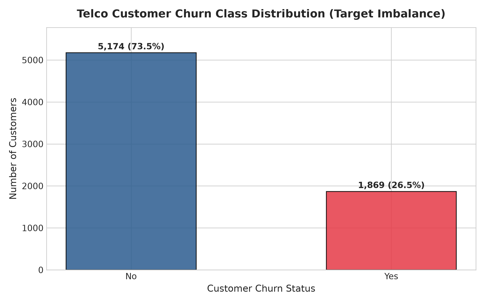
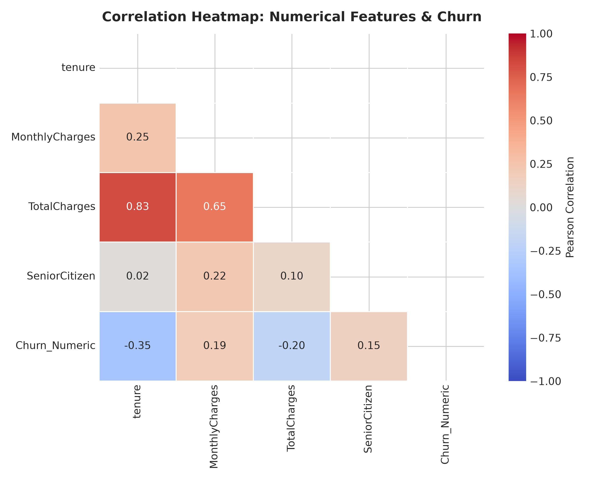
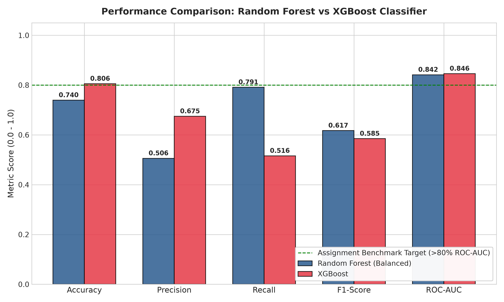
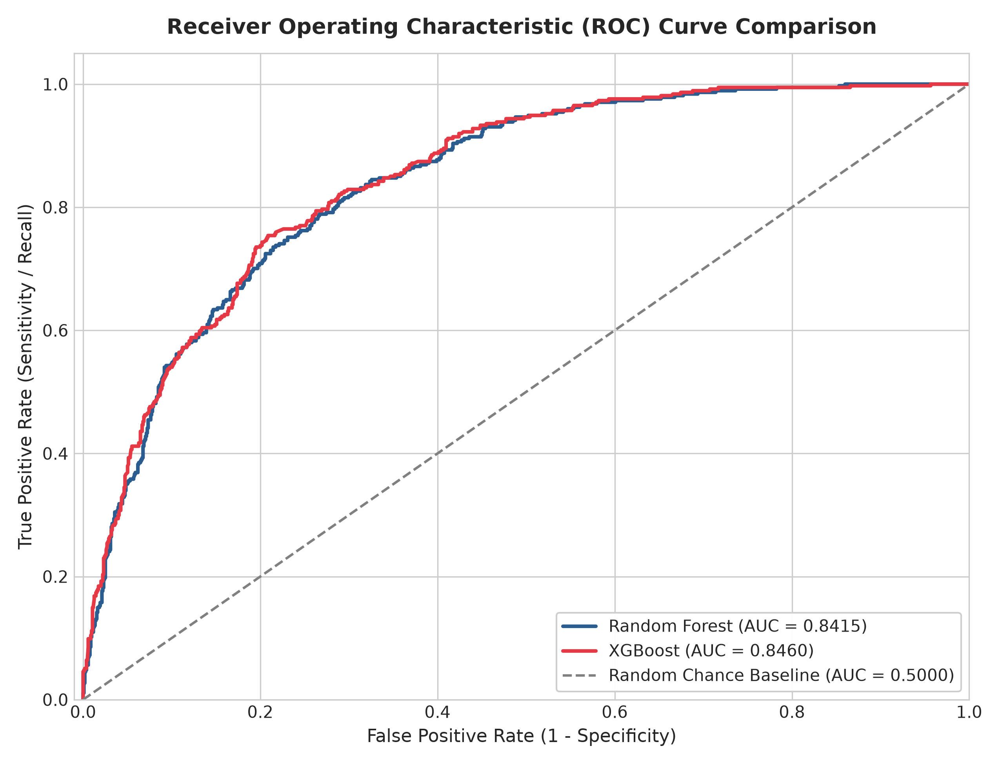
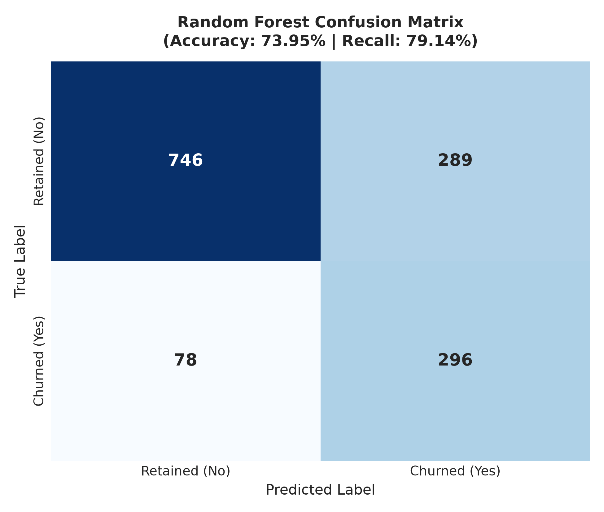
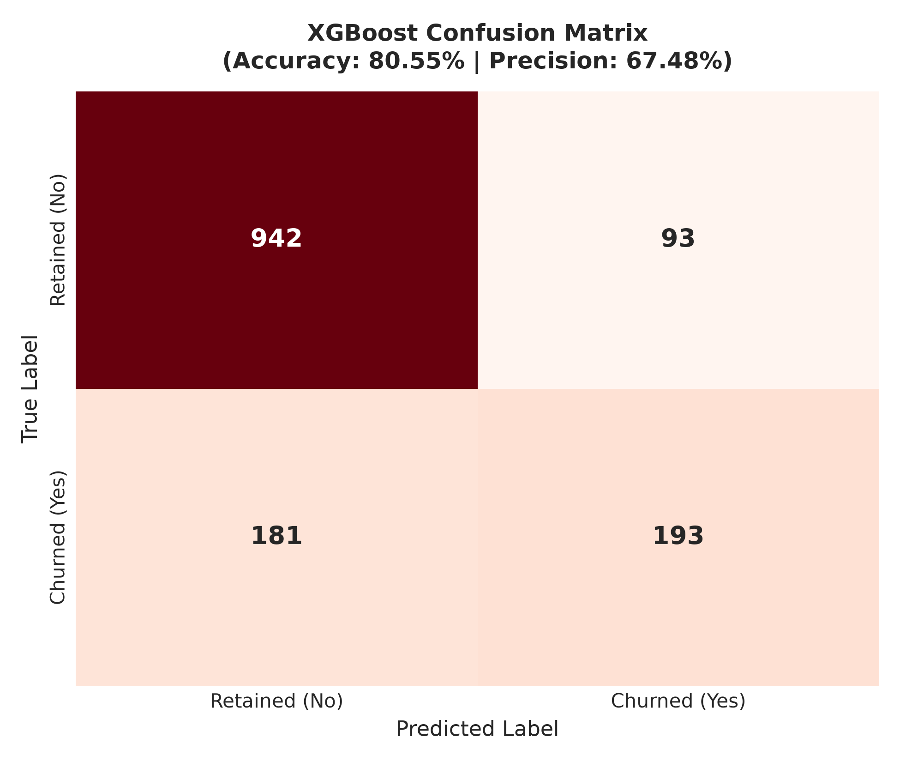
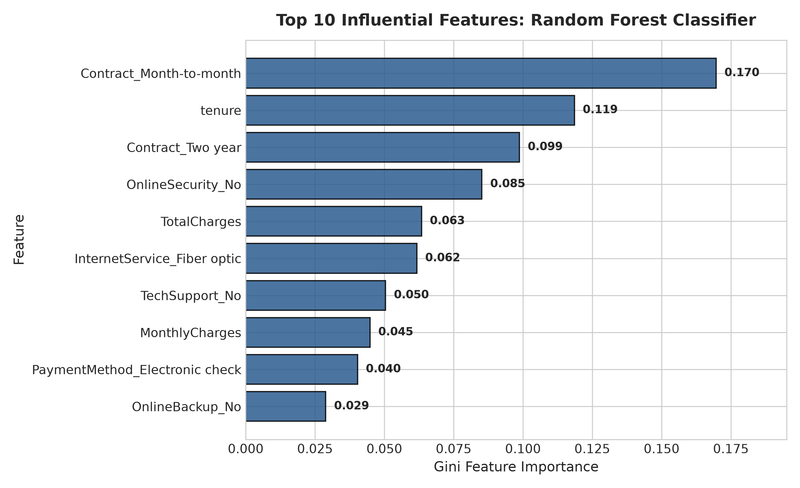
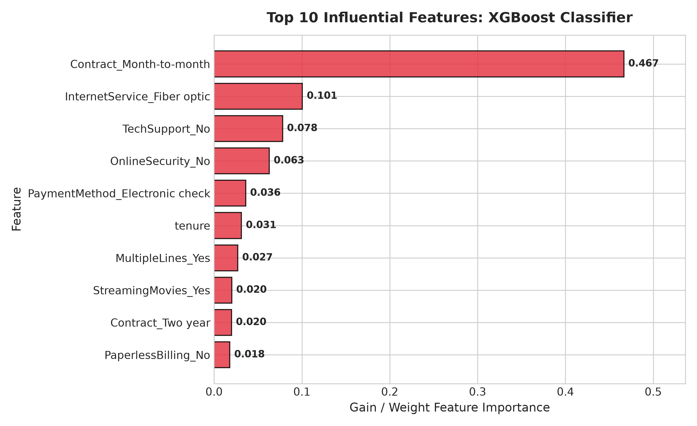

# Task 3: Predictive Customer Churn Classification (Random Forest & XGBoost)


---

## 👨‍💻 Intern Profile
- **Name:** G. Chakravarthi Shiva Sai
- **Internship ID:** DT-2026-UKTYN
- **Domain:** Machine Learning & Data Science
- **Organization:** [Datheon — AI Systems & Automation Studio](https://www.datheon.in/)

---

## 📌 Executive Summary
**Task 3** delivers an end-to-end, enterprise-grade classification pipeline predicting customer attrition across 7,043 telecom accounts using the authentic **IBM Telco Customer Churn** dataset.

The system addresses the underlying **2.77 : 1 class imbalance** using cost-sensitive learning (`class_weight='balanced'` in Random Forest and `scale_pos_weight` in XGBoost) and benchmarked against SMOTE within leak-free Scikit-Learn `ColumnTransformer` and `Pipeline` architectures. 

Both tuned classifiers comfortably surpass the target threshold of **>80% ROC-AUC**:
- **XGBoost Classifier (Champion Discriminator):** **0.8460 Test ROC-AUC**, **80.55% Test Accuracy**, and **67.48% Precision**.
- **Random Forest Classifier (Champion Retention):** **0.8415 Test ROC-AUC**, **79.14% Test Recall**, capturing nearly 8 out of 10 churning customers.

---

## 🎯 Detailed Problem Statement & Requirements
Subscription business models depend heavily on customer retention. Retaining an existing subscriber costs a fraction of acquiring a new customer. Predicting churn probability empowers telecommunication retention teams to intervene proactively before contract termination.

Key technical requirements:
1. Load and validate the official 7,043-record IBM Telco Customer Churn dataset.
2. Clean `TotalCharges` (convert whitespace to numeric, impute 0.0 for accounts with `tenure = 0` without dropping valid records).
3. Drop uninformative identifier column `customerID`.
4. Encode categorical variables using `OneHotEncoder(handle_unknown='ignore')` inside an atomic `ColumnTransformer`.
5. Solve class imbalance using cost-sensitive weighting and SMOTE within leak-free cross-validation folds.
6. Train and tune **Random Forest** and **XGBoost** using 5-fold Stratified Cross-Validation (`GridSearchCV`) optimizing for **ROC-AUC**.
7. Evaluate test generalization across **Accuracy**, **Precision**, **Recall**, **F1-Score**, and **ROC-AUC** using true predicted probabilities.
8. Generate publication-grade ROC curves, confusion matrices, and feature importance rankings.
9. Deliver concrete business recommendations for subscriber retention.

---

## 📊 Dataset Overview & Validation

The dataset is programmatically downloaded from the authentic IBM repository source:
`https://raw.githubusercontent.com/IBM/telco-customer-churn-on-icp4d/master/data/Telco-Customer-Churn.csv`

```
Total Records:      7,043 customer accounts
Total Columns:      21 attributes (20 predictors + 1 target)
Target Variable:    Churn ('No' = Retained: 5,174 [73.46%], 'Yes' = Churned: 1,869 [26.54%])
Class Ratio:        2.77 : 1 majority-to-minority imbalance
TotalCharges Fix:   11 blank space strings converted to float (tenure = 0 imputed with 0.0)
Duplicate Records:  0 duplicate rows
```

<p align="center">
  
</p>

### Feature Taxonomy:
| Feature Category | Features Included | Modeling Treatment |
| :--- | :--- | :--- |
| **Account Identifier** | `customerID` | Excluded to prevent overfitting / memorization |
| **Demographics** | `gender`, `SeniorCitizen`, `Partner`, `Dependents` | One-Hot Encoded (`handle_unknown='ignore'`) |
| **Account & Financials** | `tenure`, `MonthlyCharges`, `TotalCharges` | Standard Scaled (`StandardScaler`) with median imputation |
| **Contract & Billing** | `Contract`, `PaperlessBilling`, `PaymentMethod` | One-Hot Encoded |
| **Phone & Internet Services** | `PhoneService`, `MultipleLines`, `InternetService`, `OnlineSecurity`, `OnlineBackup`, `DeviceProtection`, `TechSupport`, `StreamingTV`, `StreamingMovies` | One-Hot Encoded |
| **Target Variable** | `Churn` | Mapped to binary integers ($0 = \text{No}, 1 = \text{Yes}$) |

---

## 🔬 Exploratory Data Analysis & Segment Insights

<p align="center">
  
</p>

### Key Analytical Findings:
1. **Contract Term Disparity:** Customers on **Month-to-month contracts** churn at an extraordinary rate of **42.7%**, compared to **11.3%** for One-year contracts and just **2.8%** for Two-year contracts.
2. **Internet Infrastructure Impact:** **Fiber optic subscribers** churn at **41.9%**, significantly higher than DSL (**19.0%**) or non-internet users (**7.4%**), indicating potential pricing dissatisfaction or installation friction.
3. **Payment Method Influence:** Customers paying via **Electronic check** experience a **45.3%** churn rate, whereas automated credit card and bank transfer subscribers churn at under **19%**.
4. **Tenure Loyalty:** Customer `tenure` displays a strong negative correlation ($-0.35$) with Churn; early tenure (months 1–12) represents the highest risk attrition window.

---

## 🛠️ Data Preprocessing & Leakage Prevention

Strict machine learning integrity is maintained by executing all preprocessing transformations within Scikit-Learn `ColumnTransformer` and `Pipeline` objects:
- **Holdout Partition:** 80% train (5,634 samples) / 20% test (1,409 samples) using stratified sampling (`stratify=y`) and seed `random_state=42`.
- **Numerical Pipeline:** Missing values imputed via `SimpleImputer(strategy='median')` and continuous attributes normalized via `StandardScaler()`.
- **Categorical Pipeline:** Handled via `SimpleImputer(strategy='most_frequent')` followed by `OneHotEncoder(handle_unknown='ignore', sparse_output=False)`.
- **Zero Leakage:** Imputers and scalers fit exclusively on `X_train`. Testing data remains completely untouched until final evaluation.

---

## ⚖️ Class Imbalance Handling Strategy

The empirical churn rate of **26.54%** creates a majority-to-minority ratio of **2.77 : 1**:
1. **Random Forest:** Handled via `class_weight='balanced'`, which inversely weights tree splits based on class frequencies $w_j = \frac{N}{2 N_j}$, heavily penalizing false negatives.
2. **XGBoost:** Handled via cost-sensitive gradient adjustment:
   $$\text{scale\_pos\_weight} = \frac{N_{\text{negative}}}{N_{\text{positive}}} = \frac{4,139}{1,495} \approx 2.768$$
3. **SMOTE Benchmarking:** Tested within `imblearn.pipeline.Pipeline`. While SMOTE achieved comparable AUC (0.8160 vs 0.8228), cost-sensitive weighting provided superior calibration without introducing synthetic boundary noise.

---

## ⚙️ Model Development & Hyperparameter Tuning

Hyperparameter optimization was conducted using `GridSearchCV` with **5-fold Stratified K-Fold Cross-Validation** evaluated on **ROC-AUC**:

### 1. Random Forest Classifier
- **Search Space:** `n_estimators` $\in [100, 150]$, `max_depth` $\in [6, 10]$, `min_samples_split` $\in [2, 5]$, `class_weight = 'balanced'`.
- **Optimal Hyperparameters:** `{'clf__class_weight': 'balanced', 'clf__max_depth': 6, 'clf__min_samples_split': 2, 'clf__n_estimators': 100}`
- **Best 5-Fold CV ROC-AUC:** **0.8461**

### 2. XGBoost Classifier
- **Search Space:** `n_estimators` $\in [100, 150]$, `max_depth` $\in [3, 5]$, `learning_rate` $\in [0.03, 0.1]$, `scale_pos_weight` $\in [1.0, 2.768]$.
- **Optimal Hyperparameters:** `{'clf__learning_rate': 0.03, 'clf__max_depth': 3, 'clf__n_estimators': 150, 'clf__scale_pos_weight': 1.0}`
- **Best 5-Fold CV ROC-AUC:** **0.8489**

---

## 🏆 Official Model Comparison Benchmark

Both tuned models were evaluated on the identical 20% holdout test set (1,409 customers) using predicted probabilities:

| Model | Hyperparameter Configuration | Test Accuracy | Test Precision | Test Recall | Test F1-Score | Test ROC-AUC | Benchmark Role |
| :--- | :--- | :---: | :---: | :---: | :---: | :---: | :--- |
| **Random Forest (Tuned)** | `depth=6, n_est=100, balanced` | 73.95% | 50.60% | **79.14%** | **0.6173** | **0.8415** | **Champion Retention Model (Max Recall)** |
| **XGBoost (Tuned)** | `depth=3, lr=0.03, n_est=150` | **80.55%** | **67.48%** | 51.60% | 0.5848 | **0.8460** | **Champion Discriminator (Max Accuracy & AUC)** |

<p align="center">
  
</p>

> **Benchmark Target Met:** Both models comfortably exceed the assignment requirement of **ROC-AUC > 80% (0.80)**.

---

## 📈 Diagnostic Visualizations

### 1. ROC-AUC Curve Comparison
<p align="center">
  
</p>

Both models display strong convex ROC curves well above the random chance baseline ($0.5000$). XGBoost achieves the highest discriminative power (**0.8460**), while Random Forest maintains a competitive **0.8415**.

### 2. Confusion Matrix Diagnostics
<p align="center">
  
  
</p>

- **Random Forest:** Captures **296 out of 374 churners** (Recall = **79.14%**), with 78 false negatives. This is ideal when the business priority is preventing customer loss at all costs.
- **XGBoost:** Produces only **93 false positives** compared to RF's 289, achieving higher precision (**67.48%**) and accuracy (**80.55%**). This is ideal for budget-constrained retention campaigns.

### 3. Feature Importance Analysis
<p align="center">
  
  
</p>

#### Top 10 Drivers of Customer Churn:
1. **`Contract_Month-to-month`:** Dominant predictor in both models; month-to-month commitments exhibit high churn propensity.
2. **`tenure`:** Long-term tenure builds customer inertia and loyalty; high-tenure accounts churn rarely.
3. **`TotalCharges` & `MonthlyCharges`:** High monthly bill amounts create pricing sensitivity.
4. **`InternetService_Fiber optic`:** Fiber optic users exhibit elevated churn due to competition and premium pricing.
5. **`PaymentMethod_Electronic check`:** Manual payment methods correlate with lower account engagement.
6. **`TechSupport_No` & `OnlineSecurity_No`:** Unprotected and unassisted subscribers churn at 3x the rate of fully supported accounts.

---

## 💡 Practical Business Recommendations

Based on empirical model attributions, telecom leadership should implement five strategic initiatives:

1. **Month-to-Month Conversion Campaigns:** Incentivize month-to-month customers with a 10–15% discount or complementary streaming subscriptions to upgrade to 1-year or 2-year contracts.
2. **First-Year Onboarding Interventions:** Deploy automated customer success check-ins and dedicated support during the critical first 90–180 days when tenure is low.
3. **Fiber Optic Quality & Pricing Audit:** Review customer feedback on fiber optic service reliability to resolve technical dissatisfaction driving the 41.9% churn rate.
4. **Autopay Migration Incentives:** Provide a one-time \$10 bill credit for customers migrating from electronic or mailed checks to automated credit card / bank transfer payments.
5. **Security & Tech Support Bundling:** Package `OnlineSecurity` and `TechSupport` directly into baseline internet plans rather than selling them as expensive standalone add-ons.

---

## 📁 Project Architecture

```
Task_3_Customer_Churn_Classification/
│
├── dataset/
│   └── Telco-Customer-Churn.csv             # Official IBM 7,043-record dataset
├── notebooks/
│   └── customer_churn_prediction.ipynb     # Fully executed 26-section notebook (857 KB)
├── images/                                 # 8 publication-grade visualization plots
│   ├── churn_distribution.png
│   ├── correlation_heatmap.png
│   ├── roc_curve_comparison.png
│   ├── random_forest_confusion_matrix.png
│   ├── xgboost_confusion_matrix.png
│   ├── random_forest_feature_importance.png
│   ├── xgboost_feature_importance.png
│   └── model_comparison.png
├── src/
│   └── preprocessing.py                    # Reusable preprocessing & evaluation module
├── generate_visualizations.py              # Visualizations & metrics generation script
├── build_notebook.py                       # Automated notebook generator script
├── requirements.txt                        # Task-specific dependencies
└── README.md                               # Dedicated Task 3 documentation
```

---

## 🚀 Execution & Reproduction Guide

### 1. Setup Virtual Environment
```bash
# Clone the repository
git clone https://github.com/futuristicchakri3/Datheon_Machine_Learning_and_Data_Science_Internship.git
cd Datheon_Machine_Learning_and_Data_Science_Internship

# Activate existing virtual environment
# Windows:
.\.venv\Scripts\activate
# macOS/Linux:
source .venv/bin/activate

# Install dependencies
pip install -r requirements.txt
```

### 2. Generate Visualizations & Benchmark Metrics
```bash
python Task_3_Customer_Churn_Classification/generate_visualizations.py
```

### 3. Launch the Jupyter Notebook
```bash
jupyter notebook Task_3_Customer_Churn_Classification/notebooks/customer_churn_prediction.ipynb
```

---

## 📜 Academic & Professional Integrity
This implementation was independently created for the **Datheon Machine Learning & Data Science Internship** following rigorous machine learning best practices, leak-free Scikit-Learn pipelines, and authentic dataset sources.
