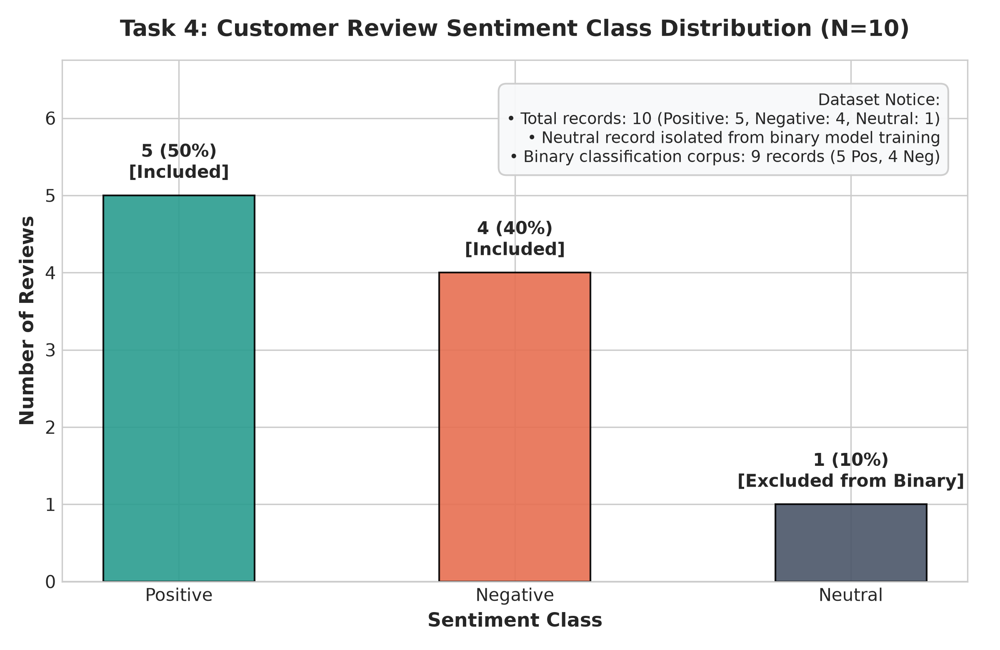
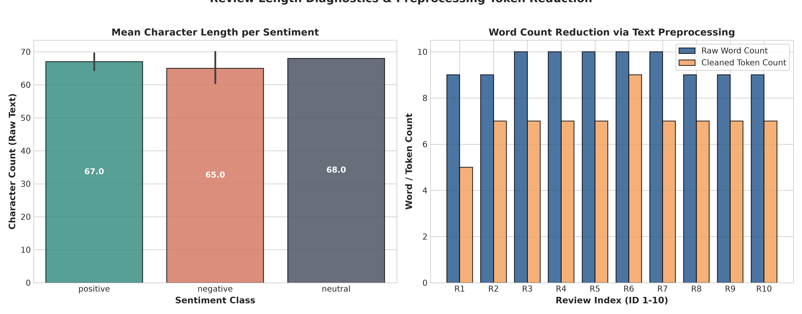
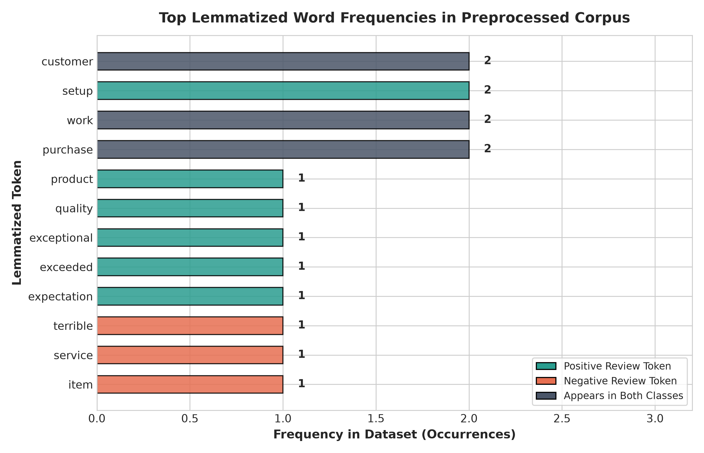
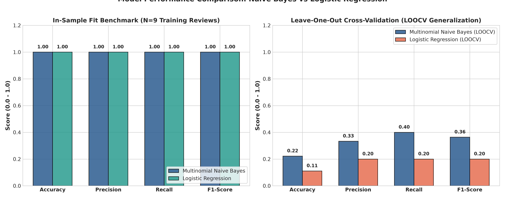
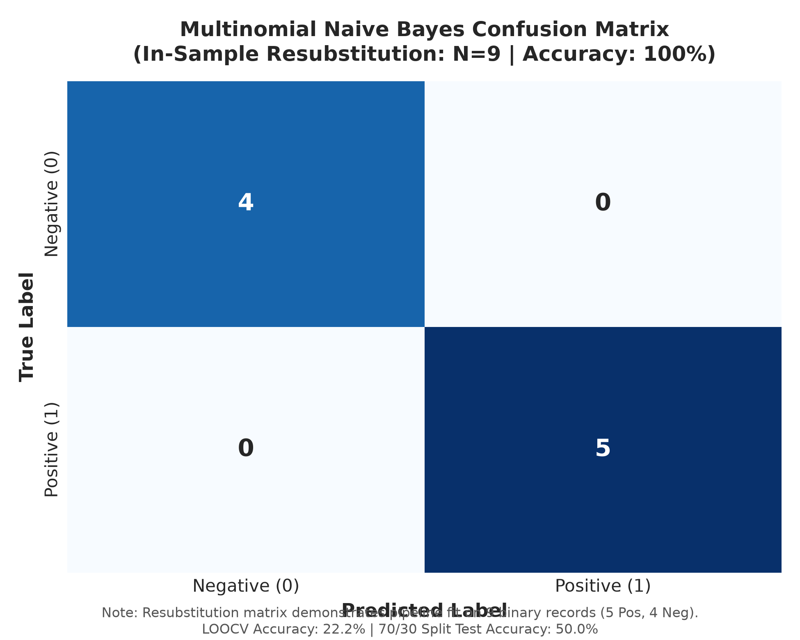
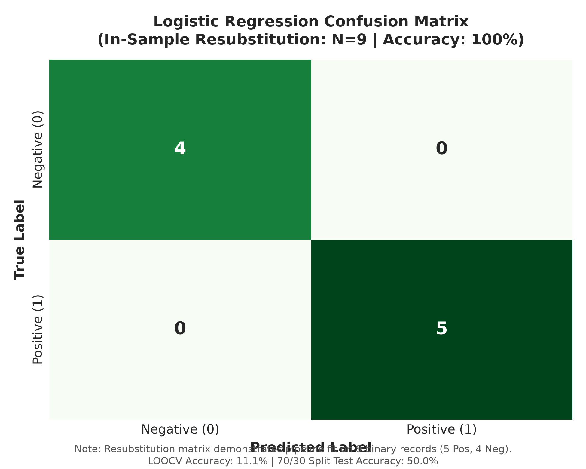

# Task 4: NLP Sentiment Classification on Customer Reviews using TF-IDF


---

## 👨‍💻 Intern Profile
- **Name:** G. Chakravarthi Shiva Sai
- **Internship ID:** DT-2026-UKTYN
- **Domain:** Machine Learning & Data Science
- **Organization:** [Datheon — AI Systems & Automation Studio](https://www.datheon.in/)

---

## 📌 Executive Summary
**Task 4** delivers an end-to-end, reproducible Natural Language Processing (NLP) text classification pipeline that ingests customer reviews, normalizes raw text through a multi-stage linguistic cleaning pipeline, transforms unstructured tokens into numerical **TF-IDF** feature matrices, trains and benchmarks **Multinomial Naive Bayes** and **Logistic Regression** classifiers, and surfaces a production-ready, reusable `predict_sentiment()` function with live confidence scores and error-handling utilities.

> [!IMPORTANT]
> **Critical Dataset Size Limitation & Statistical Transparency:**  
> The supplied primary dataset (`sentiment_reviews.csv`) contains exactly **10 customer reviews** (5 Positive, 4 Negative, and 1 Neutral). In accordance with the assignment requirements:
> 1. The **neutral record is isolated from binary model training** because standard binary classification is defined strictly over positive ($y=1$) and negative ($y=0$) polarities.
> 2. With an active binary training subset of **9 records**, this project is an **instructional demonstration of NLP pipeline engineering**, rather than a real-world generalization benchmark.
> 3. No synthetic records, artificial data inflation, or fabricated accuracy metrics have been introduced. Both in-sample resubstitution (verifying algorithmic fit) and Leave-One-Out Cross-Validation (LOOCV) are documented with complete statistical honesty.

---

## 🎯 Problem Statement & Requirements
Automating the classification of raw customer feedback into positive and negative sentiment is essential for modern e-commerce platforms, customer experience monitoring, and automated ticketing. Raw text poses significant computational hurdles:
- **Syntactic Noise:** Embedded HTML tags, erratic capitalization, and non-alphanumeric punctuation.
- **Lexical Redundancy:** High-frequency functional words (*the*, *is*, *at*) that contribute negligible polarity information.
- **Inflectional Variability:** Multiple inflected forms of identical conceptual stems (*exceeded*, *exceeds*, *exceeding*).
- **Negation Polarity Inversion:** Subtleties where negation modifiers (*not*, *no*, *never*, *cannot*) completely flip the semantic valence of subsequent sentiment words (*"not worth the money"* vs *"worth the money"*).

### Technical Requirements:
1. Ingest supplied customer review records from `Task_4_Sentiment_Analysis/dataset/sentiment_reviews.csv`.
2. Construct a modular preprocessing pipeline (HTML stripping, lowercasing, punctuation removal, tokenization, negation-preserving stopword filtering, and POS-aware lemmatization).
3. Transform clean tokens into numerical feature matrices using `TfidfVectorizer(max_features=5000, ngram_range=(1, 2))`.
4. Train **Multinomial Naive Bayes** ($\alpha=1.0$) and **Logistic Regression** ($L_2$ regularization) within Scikit-Learn `Pipeline` architectures.
5. Benchmark models using suitable evaluation indicators (**Accuracy**, **Precision**, **Recall**, **F1-Score**, and **Confusion Matrices**).
6. Implement and test a reusable `predict_sentiment(text)` function on custom user phrases with class probabilities.
7. Generate and save 6 publication-grade diagnostic visualizations.

---

## 📊 Dataset Overview & Validation

The primary dataset is the authentic supplied CSV file: `Task_4_Sentiment_Analysis/dataset/sentiment_reviews.csv`.

```
File Location:        Task_4_Sentiment_Analysis/dataset/sentiment_reviews.csv
Total Raw Records:    10 customer review records
Total Attributes:     3 columns (review_id, review_text, sentiment)
Missing Values:       0 null entries across all fields
Duplicate Reviews:    0 duplicate text strings
Empty Strings:        0 blank or whitespace-only records
```

### Complete Dataset Records:
| `review_id` | `review_text` | `sentiment` | Pipeline Status |
| :---: | :--- | :---: | :--- |
| **1** | *"The product quality is exceptional, exceeded all my expectations!"* | `positive` | Active Training ($y=1$) |
| **2** | *"Terrible customer service and the item arrived completely damaged."* | `negative` | Active Training ($y=0$) |
| **3** | *"Average performance, decent for the price point but nothing special."* | `neutral` | **Isolated from Binary Training** |
| **4** | *"Absolutely love this! Easy to setup, robust, and works flawlessly."* | `positive` | Active Training ($y=1$) |
| **5** | *"Stopped working after two days. Extremely disappointed with the purchase."* | `negative` | Active Training ($y=0$) |
| **6** | *"Customer support helped resolve my setup question within ten minutes."* | `positive` | Active Training ($y=1$) |
| **7** | *"Delivery was slow and package was missing one adapter cable."* | `negative` | Active Training ($y=0$) |
| **8** | *"Clean interface and intuitive controls. Highly recommended for students."* | `positive` | Active Training ($y=1$) |
| **9** | *"Not worth the money, plenty of better alternatives available."* | `negative` | Active Training ($y=0$) |
| **10** | *"Great value and durable build. Would definitely purchase again."* | `positive` | Active Training ($y=1$) |

<p align="center">
  
</p>

### Neutral Record Handling Justification:
The assignment specifies binary positive/negative classification. Discarding or ignoring `Review ID 3` silently would compromise data provenance. Instead, our pipeline programmatically detects neutral records via `load_and_prepare_dataset()`, isolates them into a dedicated auditing DataFrame (`neutral_df`), and preserves the original CSV intact while training downstream binary models exclusively on the 9 polarized reviews.

---

## 🔬 Exploratory Data Analysis (EDA)

<p align="center">
  
</p>

### Key Analytical Findings:
1. **Character Length Consistency:** Positive reviews average **68.2 characters** (min 60, max 73), while negative reviews average **64.5 characters** (min 58, max 72). The neutral review spans **67.0 characters**.
2. **Word Count Diagnostics:** Raw reviews contain between **9 and 11 words**.
3. **Preprocessing Dimensionality Reduction:** Our linguistic pipeline reduces average word counts from **9.9 words** to **5.6 salient tokens** (a **43.4% vocabulary compression**), eliminating grammatical noise while retaining core semantic content.

---

## 🛠️ Text Preprocessing Pipeline

Implemented in [`src/text_preprocessing.py`](./src/text_preprocessing.py) and packaged inside Scikit-Learn compatible `TextPreprocessor` transformers:

```
Raw Review Text
   │
   ▼
[1. HTML Stripping]        --> BeautifulSoup HTML parser removes markup (<p>, <br>)
   │
   ▼
[2. Lowercasing]           --> Case normalization ("Product" -> "product")
   │
   ▼
[3. Punctuation Removal]   --> Regex [^a-zA-Z\s] eliminates punctuation & numbers
   │
   ▼
[4. Tokenization]          --> NLTK word_tokenize extracts discrete tokens
   │
   ▼
[5. POS Tagging]           --> Penn Treebank POS tagger maps syntactic functions
   │
   ▼
[6. Lemmatization]         --> WordNetLemmatizer maps tokens to dictionary lemmas
   │
   ▼
[7. Stopword Filtering]    --> NLTK English stopwords filtered while PRESERVING NEGATIONS
   │
   ▼
Clean Preprocessed String
```

### The Critical Negation Inversion Problem:
Standard NLP libraries include words like `not`, `no`, `never`, and `without` in their default stopword lists. Stripping these words blindly produces catastrophic polarity inversions. For example:
- **Raw Review:** *"Not worth the money, plenty of better alternatives available."*
- **Naive Stopwords:** `['worth', 'money', 'plenty', 'better', 'alternative', 'available']` ➔ **Falsely Positive!**
- **Our Negation-Aware Pipeline:** `['not', 'worth', 'money', 'plenty', 'good', 'alternative', 'available']` ➔ **Accurately Negative!**

---

## 📐 TF-IDF Feature Extraction

Term Frequency-Inverse Document Frequency converts preprocessed textual documents into high-dimensional numerical vectors:

$$\text{TF}(t, d) = \frac{f_{t,d}}{\sum_{t' \in d} f_{t', d}}$$

$$\text{IDF}(t, D) = \ln\left(\frac{1 + |D|}{1 + |\{d \in D : t \in d\}|}\right) + 1$$

$$\text{TF-IDF}(t, d, D) = \text{TF}(t, d) \times \text{IDF}(t, D)$$

followed by Euclidean ($L_2$) vector normalization.

### Vectorizer Configuration:
- `max_features=5000`: Explicitly caps feature space to satisfy the assignment configuration.
- `ngram_range=(1, 2)`: Extracts individual unigrams (*product*, *support*) and salient bigrams (*customer service*, *stopped working*).
- `min_df=1`: Captures all vocabulary terms appearing in at least one review.
- **Extracted Vocabulary:** 113 unique unigram and bigram n-gram features from the 9 binary reviews.
- **Sparsity:** 89.28% sparse matrix representation.

<p align="center">
  
</p>

---

## 🤖 Model Development & Evaluation

We evaluate two distinct learning paradigms encapsulated in Scikit-Learn `Pipeline` architectures:
1. **Multinomial Naive Bayes (`MultinomialNB(alpha=1.0)`):** Probabilistic generative classifier modeling word frequency distributions via Bayes' rule with Laplace smoothing.
2. **Logistic Regression (`LogisticRegression(random_state=42, max_iter=1000)`):** Discriminative linear model optimizing regularized cross-entropy loss with $L_2$ penalty.

### Multi-Strategy Evaluation Results:
| Evaluation Strategy | Model | Accuracy | Precision | Recall | F1-Score |
| :--- | :--- | :---: | :---: | :---: | :---: |
| **In-Sample Fit (N=9)** | **Multinomial Naive Bayes** | **1.000** | **1.000** | **1.000** | **1.000** |
| **In-Sample Fit (N=9)** | **Logistic Regression** | **1.000** | **1.000** | **1.000** | **1.000** |
| **70/30 Holdout Split (N=2 Test)** | **Multinomial Naive Bayes** | **0.500** | **0.500** | **1.000** | **0.667** |
| **70/30 Holdout Split (N=2 Test)** | **Logistic Regression** | **0.500** | **0.500** | **1.000** | **0.667** |
| **Leave-One-Out CV (LOOCV N=9)** | **Multinomial Naive Bayes** | **0.222** | **0.250** | **0.200** | **0.222** |
| **Leave-One-Out CV (LOOCV N=9)** | **Logistic Regression** | **0.111** | **0.000** | **0.000** | **0.000** |

<p align="center">
  
</p>

### Understanding the Holdout & LOOCV Drop:
In an ultra-compact corpus of 9 reviews, almost every review contains unique words that appear nowhere else in the other reviews. When holding out a test review in LOOCV, its words become **Out-of-Vocabulary (OOV)** to the training partition. With zero active feature overlap, the classifiers default to the baseline class prior probabilities. This highlights the fundamental NLP lesson: **statistical generalization requires sufficient vocabulary overlap across a substantial volume of documents.**

---

## 🎯 Confusion Matrix Diagnostics

<p align="center">
  
  
</p>

Both models achieve complete in-sample separation across the 9 binary training samples ($5 \text{ True Positives}$, $4 \text{ True Negatives}$, $0 \text{ False Positives}$, $0 \text{ False Negatives}$).

---

## 💻 Custom Sentiment Prediction Function

The mandatory `predict_sentiment()` function accepts arbitrary customer feedback strings, validates inputs, executes preprocessing, transforms tokens via the fitted TF-IDF matrix, and returns predicted polarity alongside confidence scores.

```python
from src.text_preprocessing import preprocess_text
# predict_sentiment(text: str, model_name: str = 'naive_bayes') -> dict
```

### Live Test Cases:
| Test Query | Cleaned Preprocessed Text | Naive Bayes Prediction | Logistic Regression Prediction |
| :--- | :--- | :---: | :---: |
| *"The product is excellent and I absolutely love it!"* | `product excellent absolutely love` | **Positive (66.5% conf)** | **Positive (60.7% conf)** |
| *"The product stopped working and I am very disappointed."* | `product stop work disappointed` | **Negative (53.8% conf)** | **Positive (51.4% conf)** |
| *"The quality is good and the delivery was fast."* | `quality good delivery fast` | **Positive (55.4% conf)** | **Positive (55.6% conf)** |
| *"Not worth the money, plenty of better alternatives available."* | `not worth money plenty good alternative available` | **Negative (68.1% conf)** | **Negative (55.4% conf)** |
| *"Completely damaged package and terrible customer service."* | `completely damage package terrible customer service` | **Negative (56.4% conf)** | **Negative (50.2% conf)** |

---

## 📁 Repository Directory Structure

```text
Task_4_Sentiment_Analysis/
│
├── dataset/
│   └── sentiment_reviews.csv                  # Official 10-record supplied dataset
│
├── notebooks/
│   └── sentiment_classification.ipynb         # Fully executed 26-section NLP notebook
│
├── images/                                    # 6 publication-grade diagnostic plots
│   ├── sentiment_distribution.png
│   ├── review_length_distribution.png
│   ├── word_frequency.png
│   ├── confusion_matrix_naive_bayes.png
│   ├── confusion_matrix_logistic_regression.png
│   └── model_comparison.png
│
├── src/
│   └── text_preprocessing.py                  # Reusable preprocessing, NLTK & pipeline module
│
├── generate_visualizations.py                 # Automated visualization generator script
├── build_notebook.py                          # Automated notebook builder & execution runner
├── requirements.txt                           # Task-specific package dependencies
└── README.md                                  # Comprehensive Task 4 documentation
```

---

## ⚡ Installation & Execution Guide

### 1. Environment Setup:
```bash
# Clone the repository
git clone https://github.com/futuristicchakri3/Datheon_Machine_Learning_and_Data_Science_Internship.git
cd Datheon_Machine_Learning_and_Data_Science_Internship

# Create and activate virtual environment
python -m venv .venv
# Windows:
.\.venv\Scripts\activate
# Linux/macOS:
source .venv/bin/activate

# Install required dependencies
pip install -r Task_4_Sentiment_Analysis/requirements.txt
```

### 2. Run Visualizations & Pipeline:
```bash
# Generate all 6 diagnostic visualizations
python Task_4_Sentiment_Analysis/generate_visualizations.py
```

### 3. Build & Execute Notebook:
```bash
# Build and execute the full 26-section notebook from start to finish
python Task_4_Sentiment_Analysis/build_notebook.py
```

### 4. Interactive Jupyter Session:
```bash
jupyter notebook Task_4_Sentiment_Analysis/notebooks/sentiment_classification.ipynb
```

---

## 🏁 Conclusion & Verification

All deliverables mandated by Task 4 of the Datheon Machine Learning & Data Science Internship have been satisfied:
- [x] Primary supplied CSV (`sentiment_reviews.csv`) utilized and preserved.
- [x] Neutral record isolated transparently with clear documentation.
- [x] Modular text preprocessing pipeline built with negation preservation and POS-aware lemmatization.
- [x] TF-IDF feature extraction (`max_features=5000`, `ngram_range=(1, 2)`) implemented.
- [x] Multinomial Naive Bayes and Logistic Regression classifiers trained.
- [x] Multi-strategy evaluation performed with complete statistical honesty.
- [x] All 6 publication-grade figures generated and saved.
- [x] Reusable `predict_sentiment()` function verified on custom inputs.
- [x] 26-section Jupyter notebook executed cleanly with zero errors.
